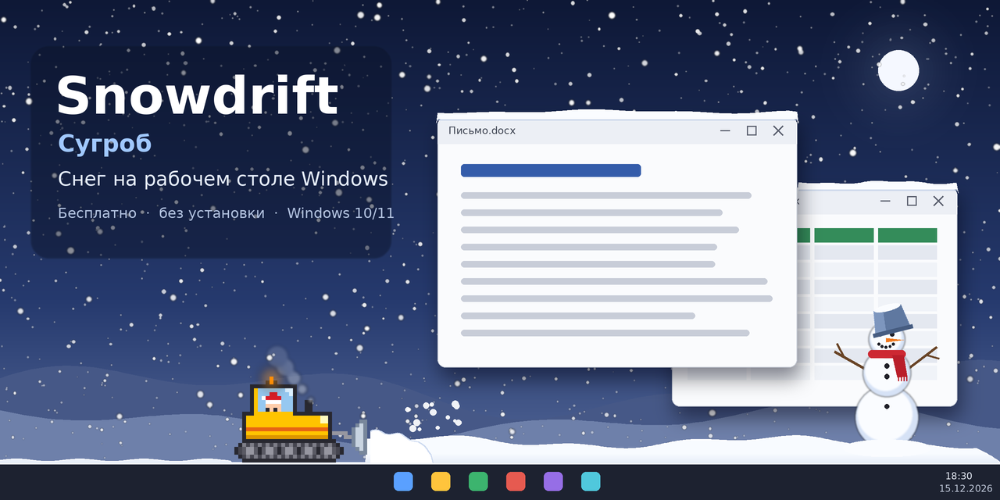

# Snowdrift (Сугроб)

Снег на рабочем столе Windows. Снежинки летят по обоям, но окна не закрывают: за окном снег проходит невидимо, а на верхних кромках окон оседает. Внизу на панели задач растёт сугроб. Когда снега набирается много, приезжает трактор и сгребает его. Сбоку постепенно лепится снеговик.

## Как поставить

1. Скачайте файл: **[Snowdrift.exe](https://github.com/Farmik74/snowdrift/releases/latest/download/Snowdrift.exe)** (около 150 КБ).
2. Запустите его. Устанавливать ничего не нужно, пойдёт снег, а у часов появится значок снежинки.
3. Если Windows покажет синее окно «Система Windows защитила ваш компьютер», нажмите «Подробнее» и «Выполнить в любом случае». Так Windows встречает любую программу без платной цифровой подписи. Код открыт и лежит здесь же.
4. Чтобы снег шёл каждый день, нажмите на снежинку у часов и включите «Запускать вместе с Windows».

Удалить: снежинка у часов → «Выход», потом удалите файл.

## Что умеет

- Снег копится на окнах. Сдвинете окно, и снег с него осыплется комьями.
- Трактор приезжает сам, когда сугроб вырос, или раз в 5–60 минут. Можно вызвать его кнопкой. Большой сугроб он чистит в два захода: упирается, отъезжает и сносит остаток с разгона.
- Снеговика можно взять мышью, поставить на окно или подбросить. Упадёт с высоты или врежется в край экрана, разлетится и через несколько секунд соберётся обратно.
- Три силы снегопада: «Слабый», «Обычный», «Метель». В метель дует ветер и кружит снег.
- Звуки: мотор трактора, удар снеговика, мелодия «В лесу родилась ёлочка» (по умолчанию выключена). Каждый звук отключается отдельно.
- Во время игр, фильмов и презентаций на весь экран снег на паузе.
- Работает на нескольких мониторах и при любом масштабе экрана от 100 до 200 %.

Все настройки в меню снежинки у часов. Двойной щелчок по снежинке включает и выключает снег.

## Требования

Windows 10 или 11. Программе нужен .NET Framework 4.8, он уже есть в Windows 11 и в Windows 10 с обновления 1903 (2019 год).

## Поддержать автора

Программа бесплатная. Если она подняла вам настроение, поддержите автора: пункт «Поддержать автора…» в меню или по ссылке https://t.tb.ru/pm_short/4wKf9LW5PqX

## Для разработчиков

Код на C#, собирается без Visual Studio: запустите `build.bat` на Windows, он соберёт `dist\Snowdrift.exe` компилятором из .NET Framework. Лицензия MIT.

---

## English

Snow on your Windows desktop. Flakes fall over your wallpaper but never cover your windows: they pass behind them and settle on their top edges. A drift grows on the taskbar, and a little tractor comes to plow it. A snowman slowly builds itself next to it; drag it onto a window or toss it, and it shatters and reassembles if it falls too hard.

**[Download Snowdrift.exe](https://github.com/Farmik74/snowdrift/releases/latest/download/Snowdrift.exe)** (about 150 KB, no installation). If Windows SmartScreen warns you, click "More info" → "Run anyway": the app is not code-signed, but the source code is right here. Turn on "Start with Windows" in the tray menu to get snow every day.

Requires Windows 10/11 with .NET Framework 4.8 (built in). The menu is in English on non-Russian Windows. MIT license.
